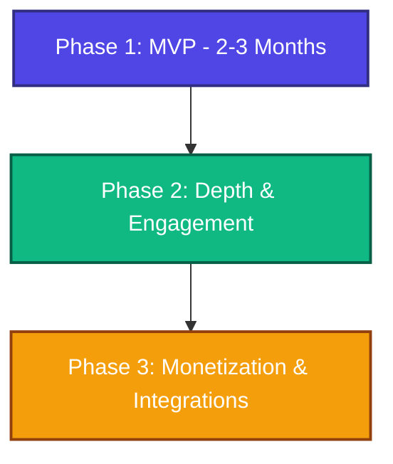
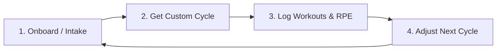
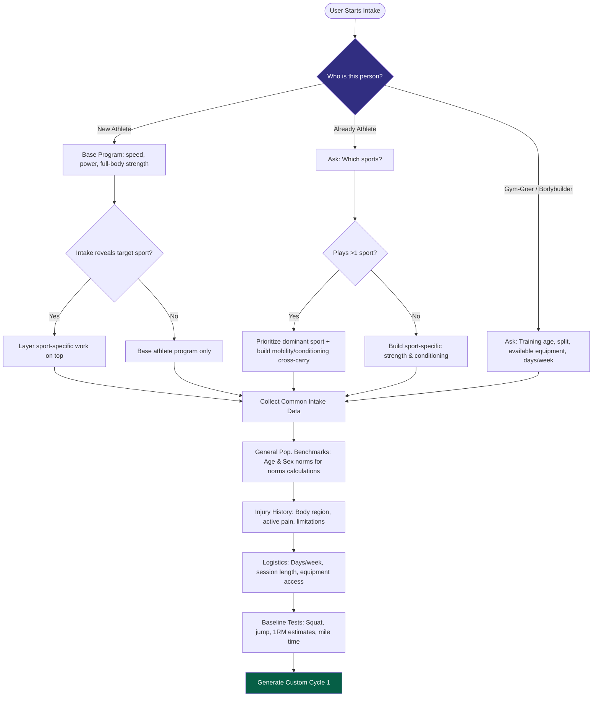
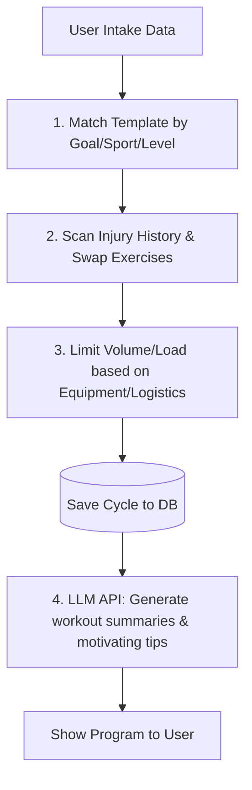
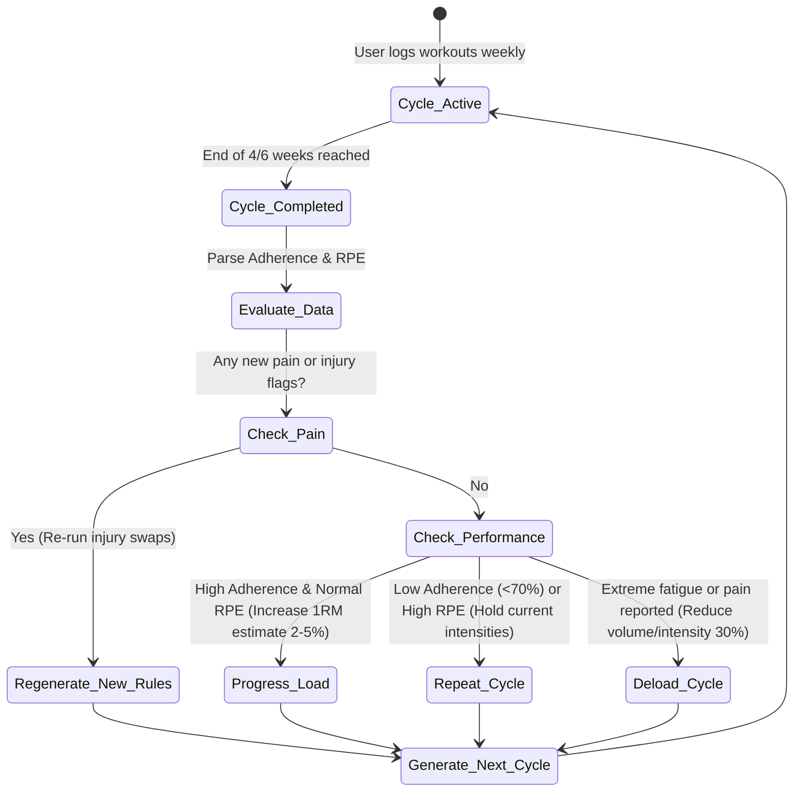

# AI Workout Coach — Product Spec & Fullstack Handoff Document

This document outlines the product requirements, system architecture, database schema, security specifications, and development roadmap for the **AI Workout Coach** application. 

---

## 0. Executive Summary & Phased Strategy (Reality Check)

To build a program-generation engine, coach marketplace, facility finder, wearable data analytics tool, and video library simultaneously is a recipe for launch delays and buggy code. To ensure a successful launch within **2-3 months**, this project is divided into distinct phases. 

**Our Goal:** Launch Phase 1 (MVP) to gather real user feedback, validate onboarding completion and program adherence, and prove retention before investing in complex integrations (wearable APIs, facility finder deals, or automated coach verification).



---

## 1. Product Summary

The **AI Workout Coach** is an athletic program-generation engine. It builds personalized training cycles based on a structured onboarding intake (goal, sport, level, injury history), dynamically adjusts programs cycle-over-cycle based on workout logging (reps, load, difficulty), and connects users with coaches and facilities in later phases.

### Core Loop


---

## 2. Onboarding & User Experience

### 2.1 First Fork (User Profiling)
Upon opening the app, users select one of three main paths:
1. **"I want to start training as an athlete"** (Beginner, wants to build sport readiness)
2. **"I already play a sport"** (Active athlete, wants strength & conditioning wrapped around their sport)
3. **"I do bodybuilding / I'm a gym-goer"** (Aesthetic or raw strength goals, no sport focus)

### 2.2 Onboarding Logic Flowchart


### 2.3 Required Intake Parameters (Engine Inputs)
*   **Goal:** Hypertrophy, performance/explosiveness, fat loss, general fitness, return-to-sport.
*   **Training Age:** Beginner (<1 yr), Intermediate (1-3 yrs), Advanced (3+ yrs).
*   **Physical Demands (if sport selected):** Jumping, sprinting, rotational power, contact, endurance.
*   **Injury History:** Active/past injury markers categorized by joint/region (Shoulder, Elbow, Wrist, Spine, Hip, Knee, Ankle, Foot).
*   **Logistics:** Days per week available (2, 3, 4, 5) and time limit per session (45m, 60m, 90m+).
*   **Equipment Access:** Full Gym, Barbell/Dumbbell only, Bodyweight/Band only.
*   **Baseline Assessments:** Simple baseline metrics (e.g., vertical jump, 1RM squat/deadlift estimate, mile time) to determine starting training intensities.
*   **Demographic Norms:** Age bracket and sex (used *only* to apply population-level strength and explosiveness norms, not stored as a user profile label).

---

## 3. Program Generation Engine Architecture

The engine uses a **Hybrid Rule-Based Core + LLM Text Enhancer** architecture. This maintains safety, control, and explainability while using LLMs for what they do best: writing human-like tips.



### 3.1 Rules vs. LLM Tradeoff
> [!IMPORTANT]
> **Safety Constraint:** The raw LLM must **never** decide exercise selection or progression increments. A hallucinated set/rep scheme or exercise for an injured joint represents a legal liability. The program structure, progression rules, and injury swaps are handled by deterministic backend code. The LLM is restricted to copywriting, tip generation, and exercise explanation.

### 3.2 Dynamic Exercise Injury-Swapping Algorithm
The exercise database categorizes items by their **Movement Pattern** and maps them to **Injury Flags** (body regions stressed). If an athlete registers a knee injury, the engine automatically filters out exercises stressing that region and swaps in a safe alternative from the same movement pattern category.

#### Mock Exercise Library Data Schema
```json
[
  {
    "id": "ex_barbell_back_squat",
    "name": "Barbell Back Squat",
    "movement_pattern": "squat",
    "body_regions": ["quads", "glutes", "lower_back"],
    "injury_flags": ["knee_pain", "lower_back_pain"],
    "video_url": "https://www.youtube.com/embed/QKKZ9QT8F5M",
    "tips": "Drive through the heels, keep chest up."
  },
  {
    "id": "ex_leg_press",
    "name": "Sled Leg Press",
    "movement_pattern": "squat",
    "body_regions": ["quads", "glutes"],
    "injury_flags": ["knee_pain"],
    "video_url": "https://www.youtube.com/embed/yZMX_D1g3hs",
    "tips": "Do not lock your knees at the top of the lift."
  },
  {
    "id": "ex_goblet_squat_box",
    "name": "Goblet Squat to Box",
    "movement_pattern": "squat",
    "body_regions": ["quads", "glutes"],
    "injury_flags": [],
    "video_url": "https://www.youtube.com/embed/pJUJ3Y5Wd_4",
    "tips": "Touch your hips lightly to the box before standing up."
  }
]
```

#### Selection and Swapping Logic
```
If User reports "lower_back_pain":
  Target Exercise: ex_barbell_back_squat (movement_pattern: "squat")
  Check: Does "lower_back_pain" exist in ex_barbell_back_squat.injury_flags? -> Yes.
  Action: Scan exercises matching movement_pattern "squat" where "lower_back_pain" IS NOT in injury_flags.
  Candidates found: ex_leg_press, ex_goblet_squat_box.
  Select exercise based on available equipment (e.g. if home-gym, pick goblet squat; if commercial gym, pick leg press).
```

### 3.3 Cycle Progression & Adaptation State Machine
Each training block (cycle) lasts **4-6 weeks**. At the end of each cycle, the state machine evaluates user logs to build the next block.



---

## 4. Feature Specifications

### 4.1 Progress Tracking & Dashboards
*   **Log Fields:** Actual Reps, Actual Weight/Load, Duration (if time-based), RPE (Rate of Perceived Exertion, 1-10 scale), and a Completion Checkbox.
*   **Visualizations:**
    *   *Strength Progression:* Estimated 1RM tracking for major multi-joint patterns (squat, hinge, push, pull).
    *   *Adherence Rates:* Percent of weekly prescribed workouts logged.
    *   *Load Profile:* Training volume ($Sets \times Reps \times Load$) mapped against expected trajectories.
*   **Trajectory Metrics:** Compare athlete's actual metrics against published standards (e.g., strength-to-weight ratios) by age, sex, and experience.

### 4.2 Wearable Upload (Phase 2)
To keep development costs low, we avoid live API integrations in the MVP.
*   **MVP Flow:** Users export standard files (`.csv`, `.json`, `.gpx`, or `.tcx`) from Garmin Connect or Apple Health, then upload them in-app.
*   **Parsing Pipeline:** Parse heart rate data, calculate session-average heart rate, peak heart rate, and training zone distribution (Zone 1 - Zone 5).
*   **Feedback System:** Automate high-level recovery tips based on wearable intensity metrics (e.g., *"You spent 25 minutes in Zone 5 today; prioritize sleep and limit high-intensity training for the next 24 hours"*).

### 4.3 Exercise Video Library
*   **Direct Embeds:** Use the official YouTube/Vimeo embed players with complete original attribution. This maintains licensing compliance, avoids copyright infringement, and offloads video hosting bandwidth costs.
*   **Phase 2/3 Upgrades:** In later phases, we can license stock footage or film custom, proprietary coaching guides.

### 4.4 Location & Facility Finder (Phase 2/3)
*   **Google Places API Integration:** Filter local search queries based on the program requirements (e.g., if the user needs track workouts, fetch nearby "running tracks" or "parks"; if strength, search for "powerlifting gyms" or "recreation centers").
*   **Affiliate Integration Schema:** Store a boolean flag `has_partner_deal` and a `referral_tracking_code` in the database. When the user visits an affiliated venue page, generate a unique tracking URL or discount code.

### 4.5 Coach Marketplace & Integration (Phase 2/3)
*   **Coach Accounts:** Separate dashboard enabling coaches to review connected athlete logs, override generated workouts, and leave direct workout notes.
*   **verification Pipeline:** Coaches submit certifications (e.g., NSCA-CSCS, NASM-PES) and identity proofs. Accounts enter a manual admin verification queue before appearing on the public directory.
*   **Content Moderation:** Templates suggested by coaches for the global rule library must pass manual admin approval before deployment.

---

## 5. Database Schema & Data Architecture

We recommend **PostgreSQL** as the primary datastore. Postgres natively supports standard relational tables (critical for user $\rightarrow$ workout $\rightarrow$ log tracking) alongside `JSONB` columns, which store flexible, nested program layouts without the schema rigidity of standard SQL.

### 5.1 Database Markup Language (DBML) Spec
Paste this DBML directly into [dbdiagram.io](https://dbdiagram.io) to view the interactive Entity Relationship Diagram (ERD).

```dbml
// Paste this directly into dbdiagram.io

Table users {
  id varchar [pk]
  name varchar [not null]
  email varchar [unique, not null]
  phone varchar
  password_hash varchar [not null]
  role varchar [not null, note: 'athlete, coach, admin']
  created_at timestamp [default: `now()`]
}

Table athlete_profiles {
  user_id varchar [pk, ref: > users.id]
  dob_or_age_bracket varchar [not null]
  sex_for_norms varchar [not null]
  sports varchar[] [note: 'Array of sport strings']
  goal varchar [not null]
  level varchar [not null]
  equipment_access varchar [not null]
}

Table injury_history {
  id varchar [pk]
  user_id varchar [ref: > users.id, not null]
  body_region varchar [not null, note: 'knee, shoulder, low_back, etc']
  description text
  status varchar [not null, note: 'active, resolved']
  reported_at timestamp [default: `now()`]
}

Table programs {
  id varchar [pk]
  user_id varchar [ref: > users.id, not null]
  created_by varchar [not null, note: 'engine, coach']
  status varchar [not null, note: 'active, completed, archived']
  current_cycle_number integer [default: 1]
}

Table program_cycles {
  id varchar [pk]
  program_id varchar [ref: > programs.id, not null]
  cycle_number integer [not null]
  start_date timestamp [not null]
  end_date timestamp [not null]
  based_on_cycle_id varchar [ref: > program_cycles.id, null]
}

Table workouts {
  id varchar [pk]
  cycle_id varchar [ref: > program_cycles.id, not null]
  day_number integer [not null]
  name varchar [not null]
}

Table exercises {
  id varchar [pk]
  name varchar [unique, not null]
  body_regions varchar[] [not null]
  movement_pattern varchar [not null]
  video_url varchar
  tips text
  injury_flags varchar[] [not null]
}

Table workout_exercises {
  id varchar [pk]
  workout_id varchar [ref: > workouts.id, not null]
  exercise_id varchar [ref: > exercises.id, not null]
  target_sets integer [not null]
  target_reps integer
  target_load varchar
  sort_order integer [not null]
}

Table logs {
  id varchar [pk]
  user_id varchar [ref: > users.id, not null]
  workout_exercise_id varchar [ref: > workout_exercises.id, not null]
  date timestamp [default: `now()`]
  actual_reps integer
  actual_load varchar
  actual_time integer
  rpe integer
  completed_bool boolean [default: false]
}

Table wearable_uploads {
  id varchar [pk]
  user_id varchar [ref: > users.id, not null]
  file_url varchar [not null]
  parsed_summary_jsonb jsonb
  uploaded_at timestamp [default: `now()`]
}

Table venues {
  id varchar [pk]
  name varchar [not null]
  latitude double
  longitude double
  sport_types varchar[]
  has_partner_deal_bool boolean [default: false]
}

Table coach_athlete_links {
  coach_id varchar [ref: > users.id, not null]
  athlete_id varchar [ref: > users.id, not null]
  status varchar [not null, note: 'pending, active']
  
  Indexes {
    (coach_id, athlete_id) [pk]
  }
}

Table password_resets {
  id varchar [pk]
  user_id varchar [ref: > users.id, not null]
  token_hash varchar [not null]
  expires_at timestamp [not null]
  used_bool boolean [default: false]
}
```

---

## 6. Security Specification

### 6.1 Authentication & Password Handling
*   **Password Hashing:** Passwords must be hashed using **bcrypt** (minimum work factor of 10) or **Argon2id**. Plaintext passwords must never hit database logs or disk storage.
*   **Password Resets:** 
    *   Do not reuse or reveal the old password hash. 
    *   Generate a cryptographically secure random token, hash it, and store the hash in `password_resets` with a strict expiration (maximum 30 minutes). 
    *   Upon successful reset, overwrite the user's password hash and immediately invalidate the reset token.

### 6.2 Data Transport & Access Controls
*   **Transport Layer Security:** Enforce HTTPS globally. Direct all HTTP traffic to HTTPS via redirect middleware. Use HTTP Strict Transport Security (HSTS) headers.
*   **Access Auditing:** Restricted endpoints (athlete logs, profiles) must implement Role-Based Access Control (RBAC). 
    *   Athletes can only view and update their own data.
    *   Coaches can access an athlete's metrics *only* if an active link exists in `coach_athlete_links`.
*   **Sanitized Errors:** Ensure login and password-reset endpoints return generic error messages (e.g., *"Incorrect email or password"*). Never disclose whether the email or password was the incorrect parameter to prevent user enumeration attacks.

### 6.3 Secure File Handling
*   **Object Storage Isolation:** Save uploaded files (wearable files, coach certifications) directly to private object storage (e.g., AWS S3, Cloudflare R2). Never store files in local webroot directories.
*   **Validation Filters:** Run server-side validation checking file size limits (e.g., max 10MB) and file-type headers. Do not rely solely on client-side constraints.

---

## 7. Phase 1 MVP — Locked Scope Checklist

The following features constitute the locked Phase 1 scope. Features outside this list are deferred to Phase 2/3.

- [ ] **Onboarding & Intake Form:** Multi-step form completing User Profiling (New Athlete, Athlete, Gym-goer) and storing goal/injuries/equipment/logistics.
- [ ] **Rule-Based Engine Core:** Templates for the first 5 core sports (Volleyball, Soccer, Jiu-Jitsu, Running, Basketball) plus basic bodybuilding and general fitness tracks.
- [ ] **Dynamic Injury Swap:** SQL filter logic replacing exercises flagged under active user pain categories.
- [ ] **Interactive Workout Logging:** Mobile-friendly dashboard displaying current workouts, exercise video embeds, and input logs for sets, reps, weight, and RPE.
- [ ] **Adherence & Progression Tracking:** Visual charts tracking workout completion percentages and estimated strength trajectories.
- [ ] **Auth Suite:** Secure signup, login, session validation, and secure password-reset flow.
- [ ] **Exercise Video Links:** Exercise table pre-populated with YouTube embeds.

---

## 8. Appendix: Rule Library Schema Mockup (For Developers)

To help developers set up the matching logic, use this standard template configuration structure (YAML) for the rule library. Developers will map intake selections directly to these configurations.

```yaml
template_id: "volleyball_beginner_power_v1"
sport: "volleyball"
level: "beginner"
goal: "power"
days_per_week: 3
weeks:
  - week_number: 1
    days:
      - day_number: 1
        focus: "Lower Body Plyometrics & Strength"
        exercises:
          - movement_pattern: "vertical_jump"
            exercise_id: "ex_depth_jump"
            sets: 3
            reps: 5
            rpe: 7
          - movement_pattern: "squat"
            exercise_id: "ex_barbell_back_squat"
            sets: 3
            reps: 8
            rpe: 8
      - day_number: 2
        focus: "Rotational Power & Core"
        exercises:
          - movement_pattern: "rotational_throw"
            exercise_id: "ex_medball_rotational_throw"
            sets: 3
            reps: 6
            rpe: 7
```
